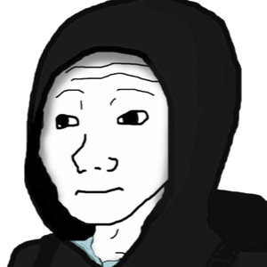

<h1 align="left"> 

</h1>

### `~$ neofetch --summary`

                     k1ran@arch
                     ----------
                     WHO               Kiran Bhattarai
          /\         ROLE              Full Stack Developer
         /  \        STACK             TypeScript | React | Node.js
        /    \       FOCUS             Backend & Databases
       /      \      PRACTICING        Data Structures & Algorithms
      /   ,,   \     EXPERIMENTING     Local LLMs & RAG systems
     /   |  |   \    CURRENTLY         Working on projects
    /_-''    ''-_\   BIG FAN OF        Exploring random tools
                     NOT A BIG FAN OF  UI designing from scratch

### `~$ cat about.md`

<ul>
<li>Full-stack developer based on Nepal.</li>
<li>Started full stack development since 2025, used to make random game automation scripts before.</li>
<li>Linux enthusiast who enjoys customizing Linux environments and experimenting with open-source tools.</li>
</ul>

### `~$ ls --stack`

### `~$ ssh contact@k1ran`

&nbsp;

&nbsp;

